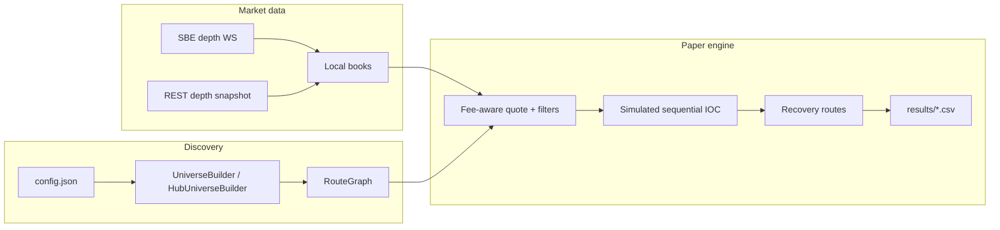

# Sequential triangular-arbitrage paper demo

Paper-only experiment: synchronized Binance L2 books, fee-aware triangular
(and short wrap) route quoting, sequential IOC **simulation**, inventory
recovery, and CSV logging.

**This is not a live trading bot, not financial advice, and not a claim of
persistent alpha.** It is a systems + microstructure learning project suitable
as a portfolio piece: show that you understand depth sync, fee drag, non-atomic
multi-leg risk, and the gap between top-of-book “edges” and executable size.

| | |
| --- | --- |
| Status | Paper simulation only — no order-placement client in the maintained path |
| Venue | Binance spot (REST + authenticated SBE depth) |
| License | [MIT](LICENSE) |

If you previously exposed an API key (chat, screenshots, old commits): **revoke
it in Binance API Management** and create a new market-data-only Ed25519 key.

## 30-second pitch

1. Discover a constrained universe of USDC or multi-hub cycles.
2. Maintain sequence-checked local order books from Binance’s ~20 ms SBE depth
   stream (REST snapshot bootstrap).
3. Detect fee-adjusted top-of-book cycles; depth-quote the best candidates at
   demo size with tick/lot/`Decimal` constraints.
4. Simulate sequential taker IOC legs with latency; recover to the hub/anchor
   if the path breaks.
5. Log theoretical episodes, candidate shadow audits, and paper trades.

Early paper evidence (see [docs/findings.md](docs/findings.md)): many
fee-positive top-of-book flashes are short-lived and **not** executable at demo
size; mega-connector triangles were effectively sterile under the fee/size
assumptions used here.

## Architecture



| Module | Role |
| --- | --- |
| `main.py` | Wire-up loop: discover → stream → paper run → daily rebuild |
| `arbitrage/config.py` | Pydantic settings from `config.json`; API key from env only |
| `arbitrage/universe.py` | USDC volume-ranked alt universe + bridges / wraps |
| `arbitrage/hub_universe.py` | Multi-hub crypto–crypto triangles |
| `arbitrage/route_graph.py` | Directed routes + recovery paths |
| `arbitrage/market_data.py` | SBE decode, book sync, coalesce batches, health metrics |
| `arbitrage/engine.py` | Strategy, quoting, episodes, recovery (no exchange orders) |
| `arbitrage/demo.py` | Virtual IOC + CSV reporters |
| `arbitrage/models.py` | Shared domain types |

Deeper rationale: [docs/design-notes.md](docs/design-notes.md).  
Limits: [docs/limitations.md](docs/limitations.md).  
Sample outcomes: [docs/findings.md](docs/findings.md), `results/sample/`.

## Setup

```bash
python3 -m venv .venv
.venv/bin/python -m pip install -r requirements.txt
cp config.example.json config.json
cp .env.example .env
# Put BINANCE_API_KEY in .env (Ed25519 key id, no trading/withdrawal).
# Keep the private key offline — this demo does not need it.
# Edit strategy knobs in config.json (prefer decimal strings).
.venv/bin/python main.py
# Or: .venv/bin/python main.py path/to/config.json
```

`main.py` prints paper fills / opportunity summaries and a market-data health
line every few minutes. It does not dump raw depth.

### Configuration

- `config.json` — strategy settings (validated by Pydantic). Start from
  `config.example.json`. **Never** put API keys here.
- `.env` / `BINANCE_API_KEY` — the only secret; required for the SBE stream.

## Paper defaults

Defaults live in `config.example.json`. Roughly:

- Starting equity: 20 USDC (USDC mode) or small hub balances (hub mode)
- Universe: quieter bridgeable alts from volume-rank ~70+; optional 4/5-leg wraps
- Max capital per cycle: 95%
- Simulated IOC latency: 40 ms
- Taker fee: 0.075% per leg (fee drag scales with leg count)
- Min net expected return: 0.05% after simulated fees
- Max normal / recovery slippage: 0.1% / 0.5%
- Stream silence / apply lag pause: 250 ms
- Dirty-symbol eval coalesce: 10 ms
- Cycle cooldown + same-route recheck before looping; recovery if inventory remains

## Results

Local runs write under `results/` (gitignored):

| File | Contents |
| --- | --- |
| `paper_trades.csv` | Every normal/recovery virtual fill |
| `opportunity_episodes.csv` | Episode completion, fees, inventory |
| `theoretical_opportunities.csv` | Fee-positive top-of-book periods |
| `candidate_opportunities.csv` | Shadow PnL + rejection flags |
| `big_pnl_results.csv` | Traded ops with marked / clean PnL % |

Committed examples: `results/sample/`.

## Tests

```bash
.venv/bin/python -m pytest
.venv/bin/ruff check .
```

CI runs the same checks on pushes/PRs to `main`
(`.github/workflows/ci.yml`).

## Repository hygiene

- Maintained path is **paper-only**.
- `archive/` holds an incomplete legacy live-order script — **do not run it**.
- Ignored: `.env`, `*.pem`, local `config.json`, `.venv`, generated `results/*`.

## CV one-liner

> Paper-only Binance spot triangular-arb simulator: synchronized L2 books from
> SBE depth, fee-aware route quoting, sequential IOC simulation with recovery,
> and opportunity logging — built to study microstructure constraints, not to
> trade live.
