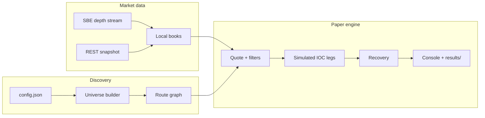

# Triangular arbitrage paper simulator

A **paper-only** Binance spot demo that looks for triangular (and short
multi-leg) cycles, prices them against live order-book depth, and simulates
taking the path with sequential IOC-style fills. Nothing in the main program
places real orders.

It accounts for taker fees, available depth, exchange size/price filters, and a
configurable reaction latency. In practice, many cycles that look fine at the
best bid/ask never clear those checks for long enough to finish.

## What it does

1. **Build a route set** from Binance REST (`exchangeInfo` + 24h volumes), either:
   - **USDC mode** — quieter USDC alts (roughly volume-rank 70+), with BTC/ETH/BNB
     only as bridges when needed; optional 4/5-leg wraps
   - **Hub mode** — triangles among a small set of hubs (e.g. BTC/ETH/BNB/SOL)
2. **Keep local L2 books** from Binance’s authenticated ~20 ms SBE depth stream,
   bootstrapped with REST snapshots and checked for sequence gaps.
3. **Score routes** after fees; for the best candidates, walk the book at demo
   size (tick/lot/`Decimal` rounding).
4. **Simulate the cycle** leg by leg. If a leg fails or the edge disappears while
   holding inventory, try a **recovery** path back to the starting asset.
5. **Log** console summaries and, on disk, CSVs under `results/` (local only;
   see `results/sample/` for committed examples).

More detail: [docs/design-notes.md](docs/design-notes.md) ·
[docs/findings.md](docs/findings.md) ·
[docs/limitations.md](docs/limitations.md)

## How the pieces fit



| Path | Role |
| --- | --- |
| `main.py` | Entry point: discover → stream → run → refresh universe |
| `arbitrage/config.py` | Settings from `config.json`; API key from the environment |
| `arbitrage/universe.py` | USDC volume-ranked universe |
| `arbitrage/hub_universe.py` | Multi-hub triangle discovery |
| `arbitrage/route_graph.py` | Directed routes and recovery paths |
| `arbitrage/market_data.py` | SBE decode, book sync, batching, health checks |
| `arbitrage/engine.py` | Detection, quoting, episodes, recovery logic |
| `arbitrage/demo.py` | Virtual fills and CSV writers |
| `arbitrage/models.py` | Shared types |

## Requirements

- Python 3.12+
- A Binance **Ed25519 API key id** with **no** trading or withdrawal permission
  (needed for the SBE market-data stream). The private key is not used by this
  project — keep it offline.

## Setup

```bash
python3 -m venv .venv
.venv/bin/python -m pip install -r requirements.txt
cp config.example.json config.json
cp .env.example .env
# Set BINANCE_API_KEY in .env
# Adjust config.json as needed (use strings for decimals)
.venv/bin/python main.py
# Optional: .venv/bin/python main.py path/to/config.json
```

While running you should see opportunity / fill lines when something passes the
filters, plus a market-data health line every few minutes. Raw depth is not
printed.

### Configuration

| File | Purpose |
| --- | --- |
| `config.json` | Strategy parameters (copy from `config.example.json`). No secrets. |
| `.env` | `BINANCE_API_KEY` only |

Defaults are documented in `config.example.json` (starting capital, fees,
slippage, latency, universe size, coalesce/silence limits, etc.).

## Outputs

Each local run can write under `results/` (gitignored):

| File | Contents |
| --- | --- |
| `paper_trades.csv` | Simulated normal and recovery fills |
| `opportunity_episodes.csv` | Per-episode completion, fees, inventory |
| `theoretical_opportunities.csv` | Periods where the top-of-book cycle cleared fees |
| `candidate_opportunities.csv` | Depth/timing audits of those periods |
| `big_pnl_results.csv` | Paper PnL for episodes that were traded in simulation |

Example rows: `results/sample/`.

## Tests

```bash
.venv/bin/python -m pytest
.venv/bin/ruff check .
```

GitHub Actions runs the same checks on `main` (`.github/workflows/ci.yml`).

## Notes

- The supported entry point is paper-only (`main.py`).
- `archive/` contains an old incomplete live-order experiment — do not run it.
- License: [MIT](LICENSE).

## AI use

Documentation in this repo was AI-generated and then human-checked. AI was also
used to help write code and shape project structure; design choices, testing,
and review remain human-owned.
